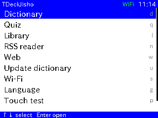
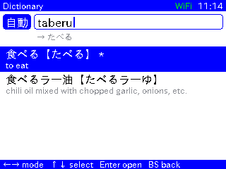
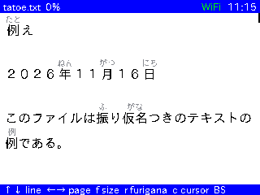
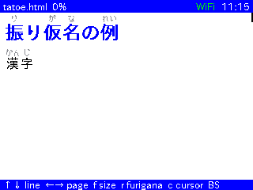
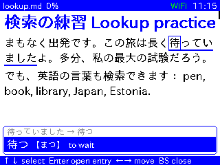
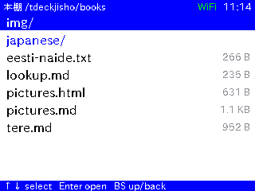
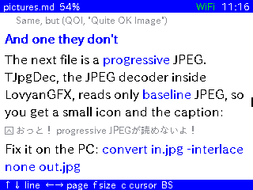
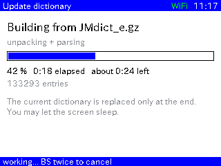

# TDeckJisho

## WARNING! AI-assisted stuff ahead!
If you oppose use use of AI tools, particularly LLMs, no ifs or buts - you may want to skip over this repository. This project started as a way to learn to know Claude Code better and get some actual experience(afterall, "know thy enemy", as they say) and realize a project I had in mind for a while. Here and there I've invervened manually and made modifications by hand. I have also used this project to understand better how firmware is written on the T-Decks and the general computing architecture. However, I am aware of the concerns and doubts surrounding the usage of these tools, so I've chosen to warn you beforehand. To end this note on a glass half full note - at least I prompted so the others won't have to. This particular paragraph is 100% human written. 

## Introduction
A pocket **Japanese ⇄ English dictionary** with an **e-book reader**, an **RSS reader** and a
**text-only web browser**, for the [LilyGO T-Deck](https://www.lilygo.cc/products/t-deck)
(ESP32-S3, 320×240 screen, keyboard, trackball). The same code runs in an **SDL window on
a PC**, so most development needs no flashing.

**Status: 0.1, a personal project.** It works in the simulator and on the device,
including the touchscreen. The UI is in Estonian, English and Japanese. Use at your own risk.

| | | |
|---|---|---|
|  |  |  |
|  |  |  |
|  |  |  |
|  |  |  |

## Features

- **Dictionary:** all of [JMdict](https://www.edrdg.org/wiki/index.php/JMdict-EDICT_Dictionary_Project)
  (215,000 entries) on the SD card, about 10 SD reads per keystroke.
  - Type **romaji**: `taberu` → たべる → 食べる (Hepburn, Kunrei and wāpuro spellings).
  - Type **English**: `eat`, `ice cream`.
  - Modes 自動 (automatic) / 和英 (Japanese-English) / 英和 (English-Japanese), switched with ← →.
  - **Update dictionary** on the device: download the newest JMdict over Wi-Fi (or use a
    copy on the card) and rebuild the index on the device itself.
- **Reader** for `.txt`, `.md` and `.html` files: Japanese line breaking, **furigana**
  (Aozora Bunko `漢字《かんじ》`, Markdown `{漢字|かんじ}`, HTML `<ruby>`), a Markdown subset,
  **pictures** (JPEG, PNG, BMP, QOI), font sizes 12/16/20, the reading position remembered
  per file.
- **Look up a word in the text:** a cursor (`c`, or a tap) and Enter: longest match first,
  with de-inflection (食べました → 食べる), katakana as news writes it (シカ → 鹿,
  子グマ → 子熊) and counters after a number (3人 → にん).
- **News** (RSS 2.0 and Atom) and a **reader-mode web browser**.
- **Wi-Fi:** scan, connect, remember networks, NTP clock.

## Quick start: the PC simulator

You need [PlatformIO Core](https://docs.platformio.org/en/latest/core/installation/), a
C++17 compiler, Python 3, and SDL2 + libcurl headers (Debian/Ubuntu:
`sudo apt install libsdl2-dev libcurl4-openssl-dev`).

```sh
pio run -e native -t exec      # build and open the SDL window
```

The simulator uses `./sdcard/` as its SD card, with sample books and pictures. The
dictionary itself is generated, not stored in git. For a 52-word sample:

```sh
tests/run.sh                                         # also builds the sample dictionary
cp -r tests/sdcard/tdeckjisho/jisho sdcard/tdeckjisho/
```

or build the full one (see [The dictionary](#the-dictionary)).

| PC key | T-Deck | Meaning |
|---|---|---|
| letters, digits, symbols | keyboard | type |
| Enter | Enter | open / confirm |
| Backspace, Esc | Backspace (del) | delete / go back |
| ↑ ↓ ← → | trackball | move, scroll, page, switch mode |
| Tab | trackball press | select / link list |
| mouse click | touchscreen | tap |
| F12 | – | screenshot to `./screenshots/` |

## On the T-Deck

The usual set-up is [Launcher](https://github.com/bmorcelli/Launcher) on the T-Deck, with
TDeckJisho installed as an app.

1. **Root certificates** for HTTPS (without them the firmware refuses every `https://`
   address, by design):
   ```sh
   cp /etc/ssl/certs/ca-certificates.crt tools/bundle/cacert.pem   # Debian/Ubuntu
   ```
2. **Build:** `pio run -e tdeck` → `.pio/build/tdeck/tdeckjisho-0.1.bin`. The log should
   say `make_ca_bundle: 1xx root certificates`.
3. **Install through Launcher:** in its WUI (Wi-Fi), upload the `.bin` on the OTA tab; or
   copy it to the SD card and install it from Launcher's SD menu.
4. **Logs:** `pio device monitor -e tdeck` (it only reads the port).

> **Don't run `pio run -e tdeck -t upload` on a T-Deck that runs Launcher.** It is a
> full flash (bootloader, partition table, app) and replaces Launcher. Without Launcher
> it's the normal way to flash.

### The SD card (FAT32)

Everything lives in one folder, so it never collides with Launcher or other firmware:

```
/tdeckjisho/jisho/    entries.dat  kana.idx  kanji.idx  eng.idx  info.txt   the dictionary
/tdeckjisho/jmdict/   JMdict_e.gz                                for "Update dictionary"
/tdeckjisho/books/    your .txt / .md / .html files (+ pictures)
/tdeckjisho/config/   feeds.txt, settings.txt, positions.txt; wifi.txt only to import networks
/tdeckjisho/LICENCES/ JMdict credits
```

## The dictionary

Get `JMdict_e.gz` (the English-only JMdict) from the EDRDG:
<https://www.edrdg.org/pub/Nihongo/JMdict_e.gz>. Then any of:

- **On the PC** (≈12 s, Python standard library only):
  `python3 tools/jmdict2jisho.py JMdict_e.gz sdcard/tdeckjisho/jisho`
- **An SD bundle** with the dictionary, sample books, credits and firmware:
  `tools/make_sd_bundle.sh JMdict_e.gz` → `dist/tdeckjisho-sd-YYYYMMDD.zip`; unzip it onto
  the card.
- **On the device:** Home → Update dictionary (`u`; it reads *Download dictionary* while
  there is none), download over Wi-Fi or build from a file in `/tdeckjisho/jmdict/`.

Japanese books from [Aozora Bunko](https://www.aozora.gr.jp) are Shift_JIS; convert them
once with `iconv -f SHIFT_JIS -t UTF-8 in.txt > out.txt`.

## Tests

```sh
tests/run.sh                      # unit tests, with AddressSanitizer + UBSan
tests/build_compare.sh JMdict_e   # on-device builder vs Python converter, byte for byte
tests/bench.sh                    # search speed and SD operation counts
```

## Source layout

```
platformio.ini     two environments: tdeck (ESP32-S3) and native (SDL)
src/
  main.cpp         setup()/loop(), the same on both targets
  hal/             Hal.hpp: THE hardware interface; tdeck/ and sdl/ implement it
  core/            plain C++: UTF-8, romaji, URLs, settings, de-inflection, paths,
                   Strings.def (every UI text in three languages)
  dict/            dictionary search, and the on-device dictionary builder
  text/            rich-text format, layout, Markdown/Aozora/HTML/RSS parsers, pictures
  ui/              App (screen stack, main loop), theme, widgets, renderer
  screens/         the screens, and Actions.cpp (navigation)
tools/             JMdict converter, SD bundle, firmware naming, CA bundle, sample data
tests/             unit tests, benchmarks, converter comparison, sample SD card
sdcard/            the simulator's SD card
docs/              how it works and how to change it
```

## How this was made

Most of this code was written with an AI assistant (Anthropic's Claude), first as a
step-by-step teaching prototype and then reshaped into this project. The test suite and
the sanitizer builds are how its behaviour is checked; read the code with that in mind.
The Estonian and Japanese UI texts were initially written by the assistant and but have since been reviewed by the developer.

## Licence

The source code is under the [MIT licence](LICENSE). The firmware also contains LovyanGFX
and fonts under their own licences, and the dictionary data is JMdict © EDRDG under
CC BY-SA 4.0: see [THIRD-PARTY-NOTICES.md](THIRD-PARTY-NOTICES.md).

This package uses the JMdict/EDICT dictionary files. These files are the property of the
Electronic Dictionary Research and Development Group, and are used in conformance with the
Group's licence.
